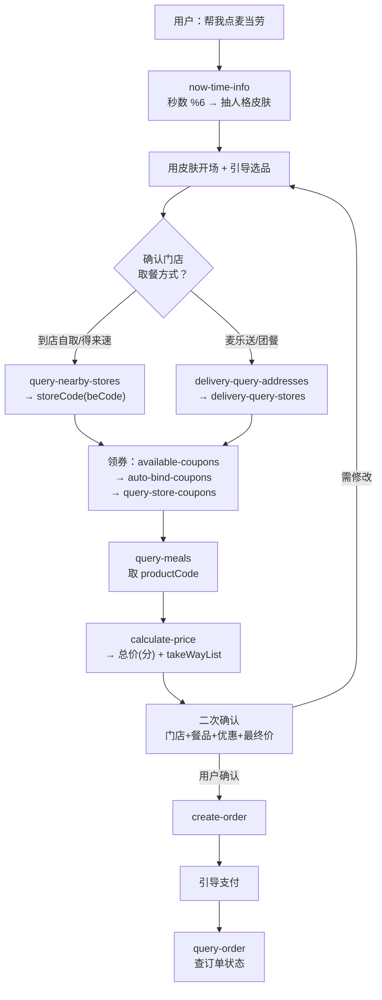

# MCP 集成说明 · maimai-fun-orderer

本文件说明「麦麦整活点餐官」实际调用的**麦当劳 MCP Server**、用到的 **Tool**、**端到端调用流程**，以及这套集成带来的**业务价值**。

---

## 一、麦当劳 MCP Server

| 项 | 说明 |
|----|------|
| MCP 名称 | `mcd-mcp`（麦当劳到店/外送点餐 MCP Server） |
| 作用 | 提供麦当劳门店查询、餐品查询、优惠券、算价、下单、订单查询等能力 |
| 连接方式 | 在 WorkBuddy 中作为 MCP Connector 接入并授权（需登录麦当劳账号） |
| 本技能定位 | **编排层**：不自己算价/记账，所有价格与订单状态均以 MCP 返回为准 |

> 本技能**不直接调用麦当劳 HTTP 接口**，而是通过 `mcd-mcp` 暴露的工具完成一切读写操作。

---

## 二、用到的 Tool 清单

### 1. 时间与随机

| Tool | 入参 | 在本技能中的作用 |
|------|------|------------------|
| `now-time-info` | 无 | 取服务器时间戳 → `floor(timestamp/1000)%60` 得秒数 → `%6` 随机选人格皮肤；同时供预约场景使用 |

### 2. 门店与地址

| Tool | 关键入参 | 作用 |
|------|----------|------|
| `query-nearby-stores` | `beType(1\|5)`, `searchType(1\|2)`, `city`, `keyword` | 到店自取 / 得来速场景查门店，返回 `storeCode`（得来速含 `beCode`） |
| `delivery-query-addresses` | 无 | 外送/团餐场景查用户配送地址列表，取 `addressId` |
| `delivery-query-stores` | `beType(2\|6)`, `addressId` | 按地址查可配送门店，返回 `storeCode` + `beCode` |

### 3. 餐品

| Tool | 关键入参 | 作用 |
|------|----------|------|
| `query-meals` | `storeCode`, `orderType`, `beType`, `[beCode]` | 拉取门店在售餐品与 **`productCode`**（选品以此为准） |
| `query-meal-detail` | `storeCode`, `orderType`, `beType`, `code`, `[beCode]` | 查单品组成、默认搭配、是否可特调（`supportModify`） |

### 4. 优惠券与促销

| Tool | 关键入参 | 作用 |
|------|----------|------|
| `available-coupons` | 无 | 查当前**可领取**的麦麦省券 |
| `auto-bind-coupons` | 无 | **一键领取**全部可领券 |
| `query-store-coupons` | `storeCode`, `orderType`, `beType`, `[beCode]` | 查**指定门店+订单类型可用**的券（下单前挑券用） |
| `query-my-coupons` | `[page]`, `[pageSize]` | 查用户卡包券（仅展示，不校验门店可用性） |
| `query-promotions` | `storeCode`, `orderType=2`, `beType=6`, `[beCode]` | 团餐场景查满减/满折规则 |

### 5. 交易与订单

| Tool | 关键入参 | 作用 |
|------|----------|------|
| `calculate-price` | `storeCode`, `orderType`, `beType`, `items[]`, `[beCode]`, `[needTableware]`, `[reservationDate]`, `[withOrder]` | **算价**：返回各项价格、优惠与总价（单位"分"）、`takeWayList[]` |
| `create-order` | `storeCode`, `orderType`, `beType`, `items[]`, `[takeWayCode]`, `[addressId]`, `[beCode]`, `[remark]`, … | **创建订单**（真实下单） |
| `query-order` | `orderId` | 查询订单状态与配送进度 |
| `query-my-account` | 无 | 查积分账户 |

> `mcd-mcp` 还提供抽奖、积分商城、团餐派对、问卷领券等工具；本技能聚焦"点餐主链"，未纳入核心流程。

---

## 三、端到端调用流程

### 分步说明

1. **掷骰子**：`now-time-info` → 秒数 `%6` → 选皮肤（`0 天意 / 1 抽卡 / 2 反向 / 3 恶魔vs教练 / 4 薛定谔 / 5 忏悔室`）。
2. **确认门店**：
   - 到店自取 / 得来速 → `query-nearby-stores`（收藏优先，无则按城市+关键词搜）。
   - 麦乐送 / 团餐 → `delivery-query-addresses` → `delivery-query-stores`。
3. **领券**：`available-coupons` 看券 → `auto-bind-coupons` 领取 → `query-store-coupons` 挑当前门店可用的券。
4. **查餐品**：`query-meals` 拿真实 `productCode`；需要看组成/特调用 `query-meal-detail`。
5. **算价**：`calculate-price` 传入 `items` + 优惠券，得到总价（分）与 `takeWayList`。
6. **二次确认**（强制）：把门店、方式、餐品、优惠、最终价格完整复述，等用户明确同意。
7. **下单**：`create-order`（到店需 `takeWayCode`，外送需 `addressId`）。
8. **支付与查单**：引导扫码/APP 支付，用户回"支付完成"时用 `query-order` 查状态。

---

## 四、关键参数规则与常见坑

### beType / orderType 配对

| 场景 | beType | orderType | beCode | 下单必需项 |
|------|--------|-----------|--------|-----------|
| 到店自取 | 1 | 1 | ❌ 不传 | `takeWayCode` |
| 得来速 DT | 5 | 1 | ✅ 必传 | `takeWayCode` |
| 麦乐送 | 2 | 2 | ✅ 必传 | `addressId` |
| 企业团餐 | 6 | 2 | ✅ 必传 | `addressId` + `gmServiceCode` |

### 高频坑位

- ⚠️ **到店自取(beType=1) 不要传 `beCode`**，传了会报错。
- ⚠️ **价格单位是"分"**，展示必须 `/100` 转"元"，严禁自行估算。
- ⚠️ **到店下单漏 `takeWayCode`**、**外送下单漏 `addressId`** → 直接报错。`takeWayCode` 取自算价返回的 `data.takeWayList[].code`。
- ⚠️ `query-my-coupons` 的券**不校验门店可用性**，下单挑券要用 `query-store-coupons`。
- ⚠️ `storeCode` 必须为**纯数字**。
- ⚠️ 预约场景才传 `reservationDate`（`yyyy-MM-dd HH:mm`），即时单不传。

---

## 五、业务价值

| 维度 | 价值 |
|------|------|
| **降低决策成本** | 用户常"不知道吃什么"。6 人格皮肤用求签/抽卡/排除法等方式，把"选择困难"变成一种游戏，快速收敛到一个可下单的清单。 |
| **提升转化与客单** | 人格引导中会自然推荐"主堡 + 小食 + 饮料"组合；内置领券动作（`available-coupons` → `auto-bind-coupons`）让用户更容易凑单、用券。 |
| **端到端闭环** | 从"想吃什么"到"真实下单 + 支付"全链路打通，不是只聊不买。 |
| **安全可控** | `create-order` 前**强制二次确认**，价格以接口为准，避免误下单与价差纠纷。 |
| **可复用的编排范式** | "随机角色皮肤 + 统一业务闭环"是一种可迁移的设计：外壳娱乐化，内核标准化（确认门店→领券→算价→确认→下单）。 |
| **传播与演示友好** | 人格皮肤自带话题性，适合直播、短视频、活动暖场等场景，为品牌/平台带来自然传播。 |

---

## 六、延伸阅读

- [`README.md`](./README.md) —— 项目介绍、安装、使用示例、目标用户。
- [`SKILL.md`](./SKILL.md) —— 技能主逻辑。
- [`references/personas.md`](./references/personas.md) —— 6 人格皮肤脚本。
- [`references/ordering-flow.md`](./references/ordering-flow.md) —— 工具调用顺序与参数细则。
